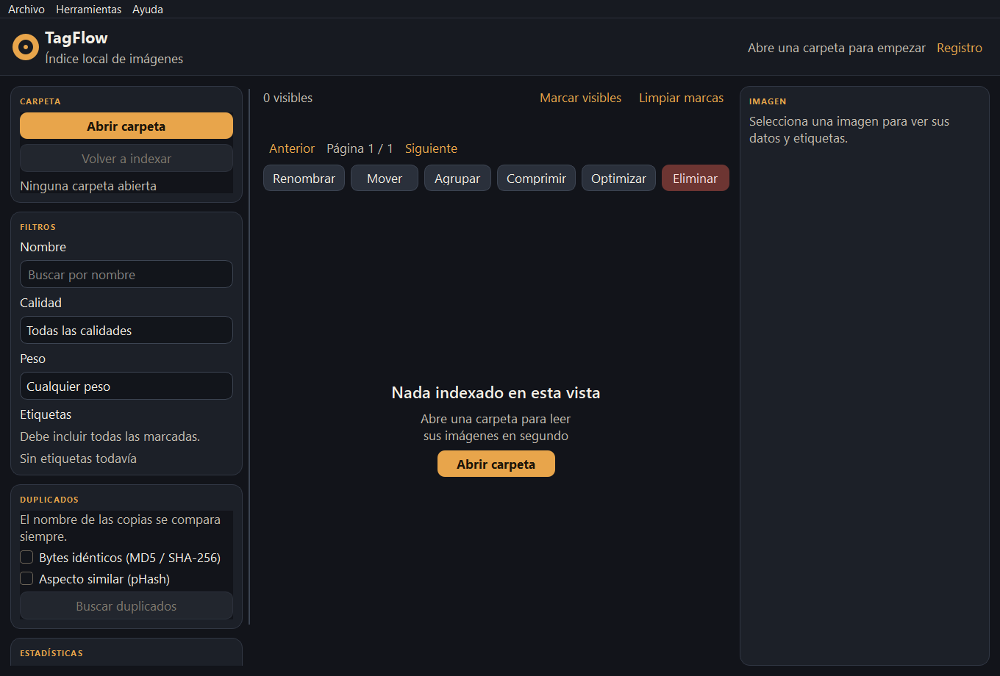
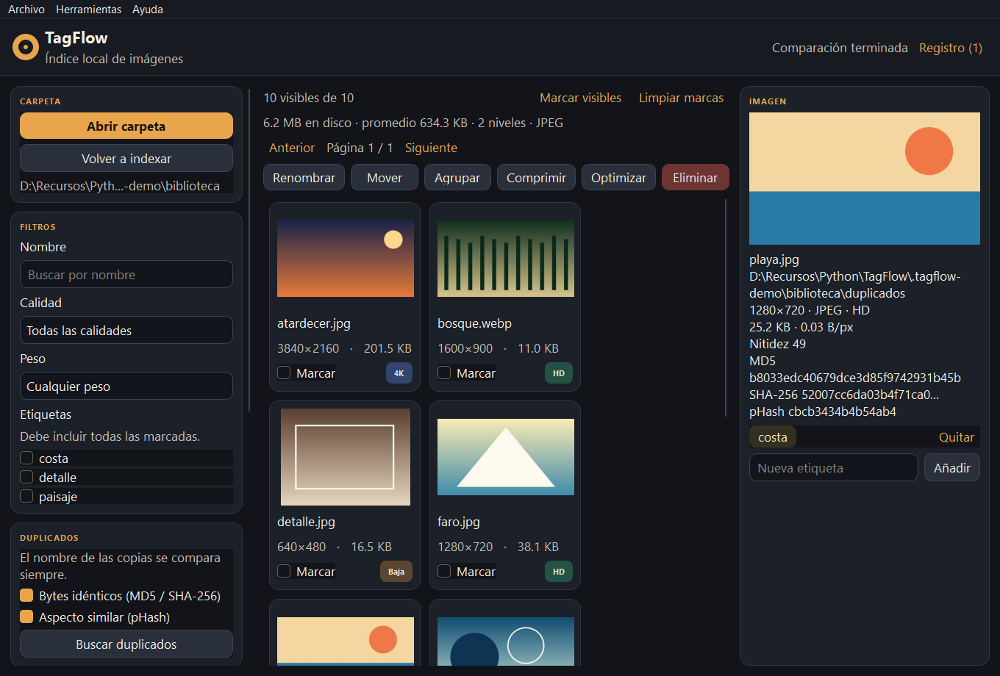
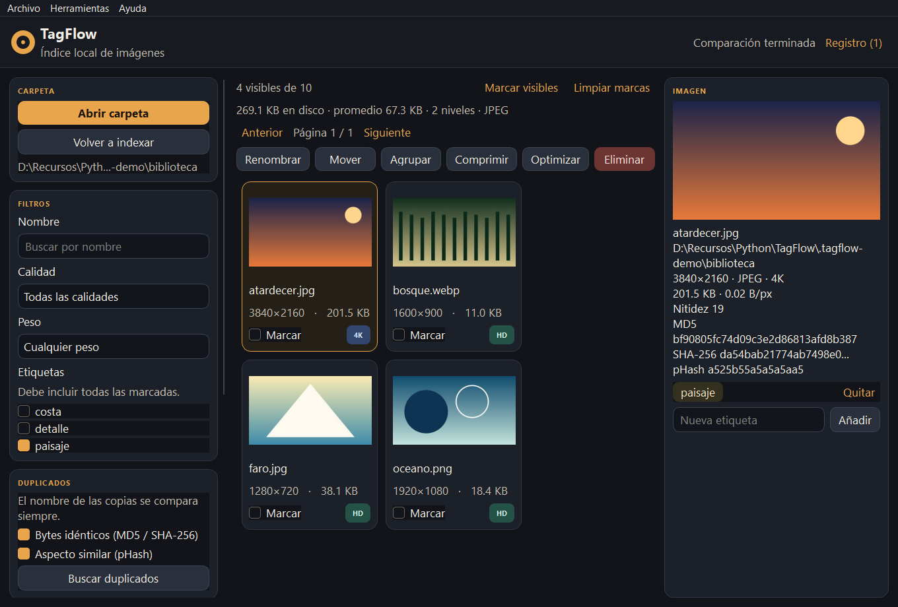
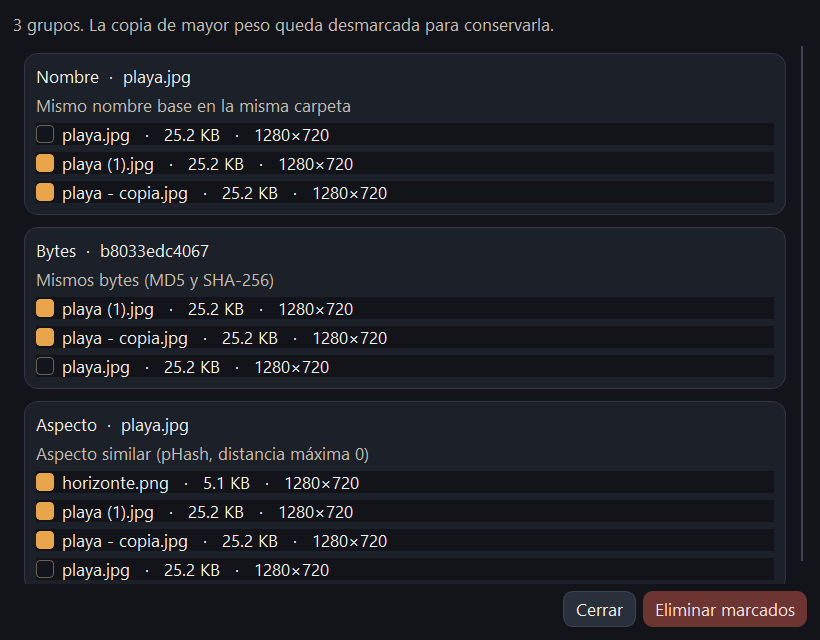
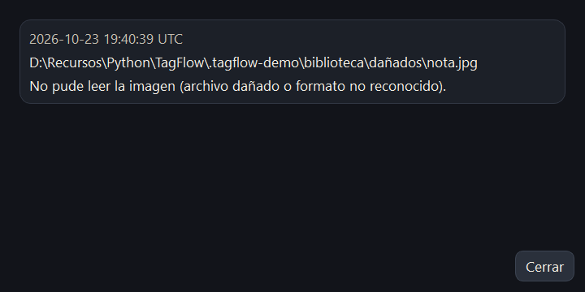
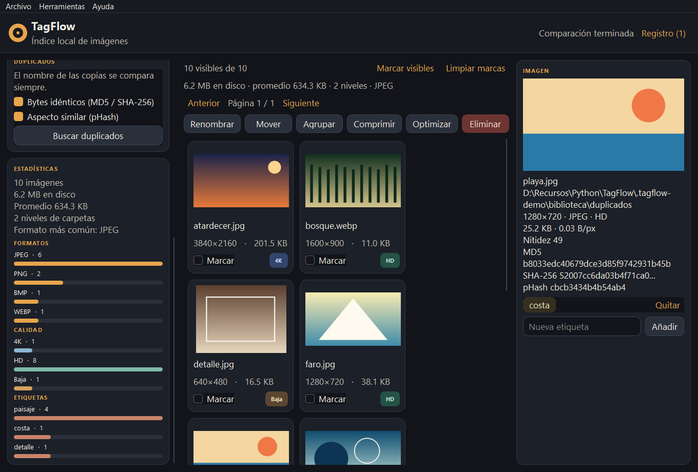

# TagFlow

TagFlow es una aplicación de escritorio para ordenar una carpeta de imágenes sin salir del equipo. Indexa dimensiones, peso y formato, deja etiquetar, filtra la biblioteca, busca duplicados y puede agrupar, comprimir u optimizar los archivos seleccionados.

El índice vive en SQLite. Las miniaturas, el registro y los cálculos se quedan en este ordenador.

**Autor:** [HugoFernandoColmenares](https://github.com/HugoFernandoColmenares)

## Capturas

Las imágenes salen de la aplicación en ejecución.

### Inicio



### Biblioteca



### Filtro por etiqueta



### Duplicados



### Registro de errores



### Estadísticas



## Requisitos

- Windows
- Python 3.11 o superior para ejecutar desde el código
- El ejecutable no necesita Python instalado

## Ejecutar desde el código

```powershell
python -m venv .venv
.\.venv\Scripts\Activate.ps1
pip install -r requirements.txt
python -m tagflow
```

## Ejecutable

El empaquetado deja un solo archivo en `dist\TagFlow.exe`. El primer arranque tarda unos segundos: PyInstaller desempaqueta Python, Qt y OpenCV en una carpeta temporal.

Para generarlo de nuevo:

```powershell
.\.venv\Scripts\pyinstaller.exe --noconfirm --clean --windowed --onefile --name TagFlow --icon tagflow\assets\icon.ico --add-data "tagflow\assets;tagflow\assets" tagflow\main.py
```

## Configuración

Copia `.env-template` a `.env` si quieres cambiar la carpeta de datos, el nivel de registro o el tamaño de las miniaturas. Con `TAGFLOW_DATA_DIR` vacío, TagFlow usa `%USERPROFILE%\.tagflow`.

## Bibliotecas grandes

TagFlow 1.1 está pensado para carpetas con miles de imágenes:

- La galería pagina de 96 en 96; no crea una tarjeta Qt por cada archivo.
- El índice guarda por lotes y reutiliza entradas cuyo tamaño y fecha no cambiaron.
- La nitidez con OpenCV se calcula al inspeccionar una foto, no durante el análisis.
- El pHash agrupa por prefijo para no comparar las 14k fotos entre sí.
- Un segundo indexado de la misma carpeta debería ser mucho más rápido que el primero.

## Pruebas

```powershell
.\.venv\Scripts\python.exe -m pytest
```

## Diseño

La estructura del programa sigue [docs/guides/ARCHITECTURE.md](docs/guides/ARCHITECTURE.md).
